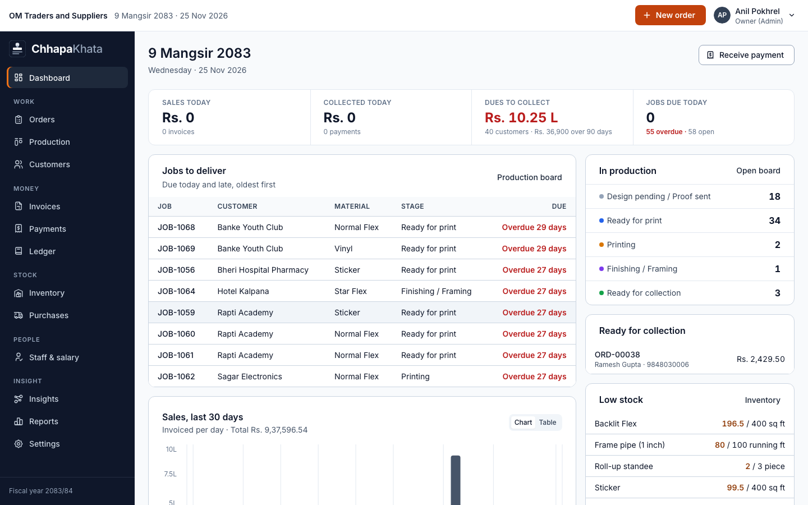
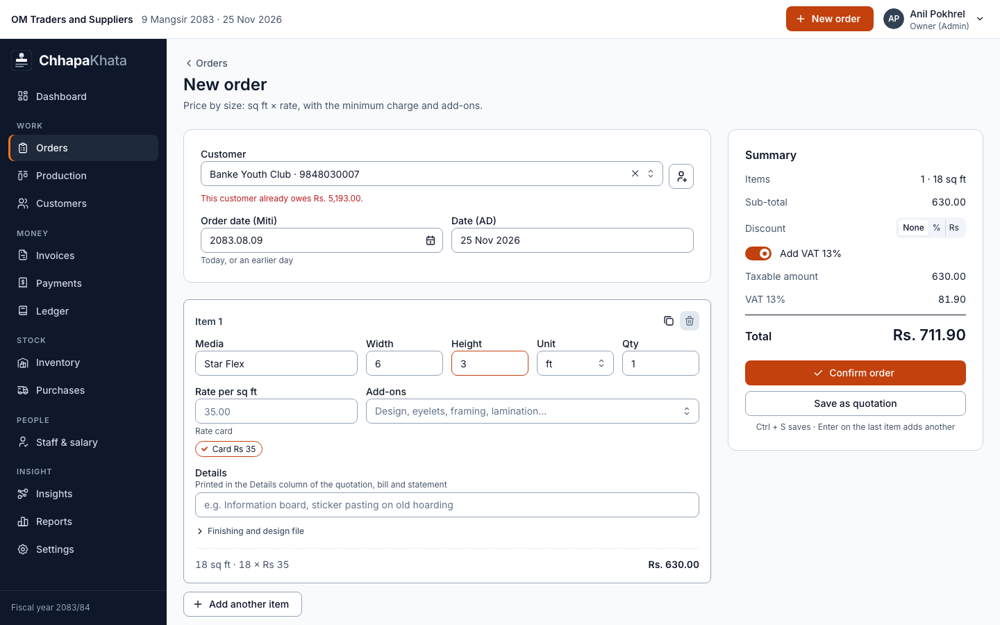
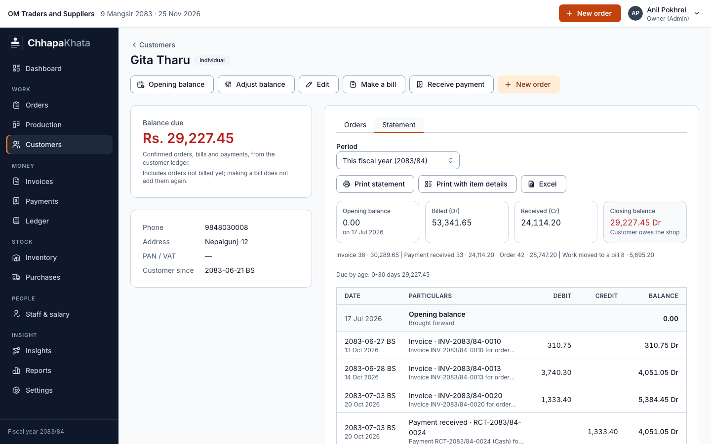
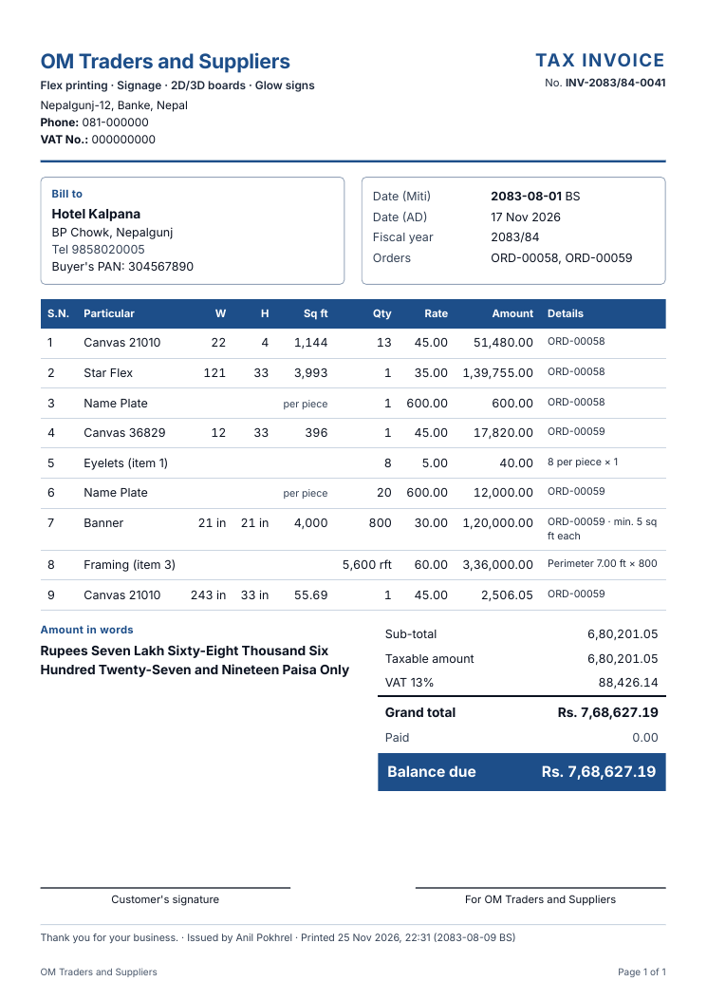
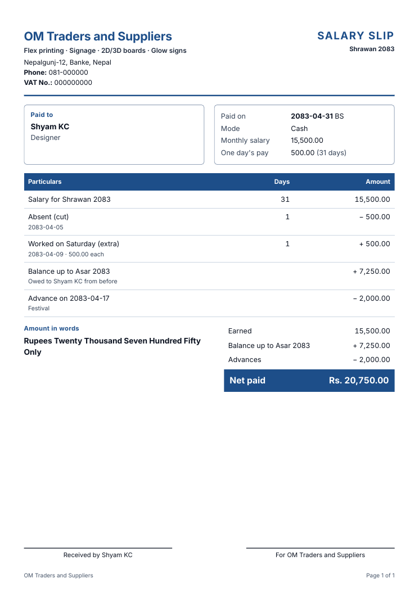
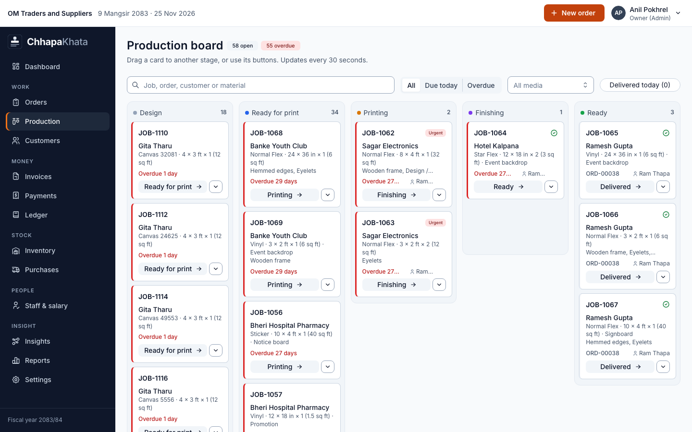
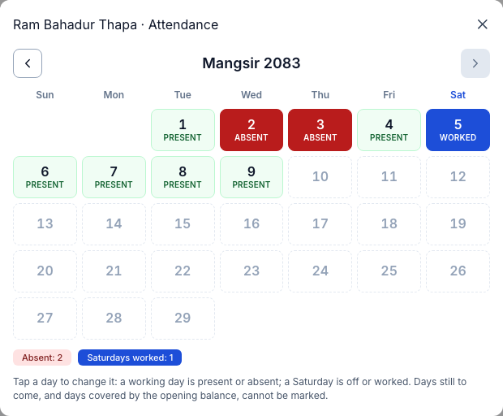
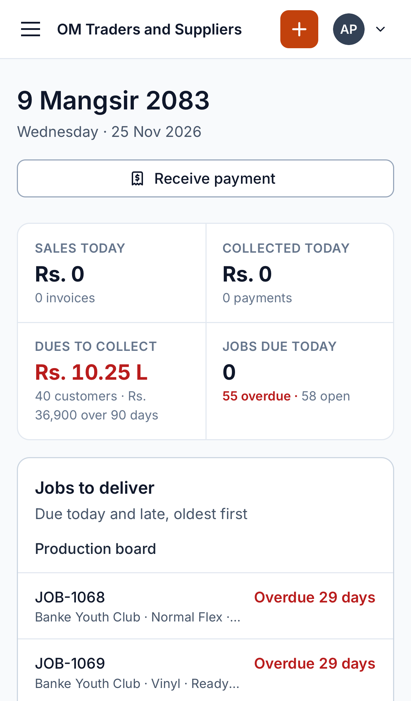
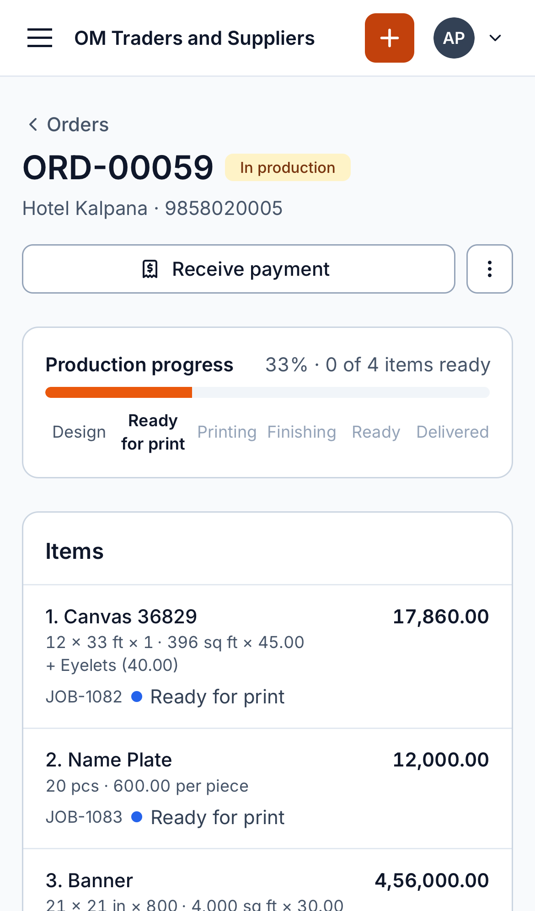

<p align="center">
  <picture>
    <source media="(prefers-color-scheme: dark)" srcset="docs/images/logo-dark.svg">
    
  </picture>
</p>

<p align="center">
  <b>Print shop management for Nepal.</b><br>
  Orders priced by the square foot, VAT bills in Bikram Sambat, the customer khata,<br>
  stock, staff salary and reports, in one web app for the counter, the office and the phone.
</p>

<p align="center">
  
  
  
  
  
</p>

---

*Chhapa* (छापा) means print and *khata* (खाता) the account book.

ChhapaKhata runs a flex, banner, signage and photo printing house: the counter takes orders priced by size, the owner sees every rupee owed and received, bills follow Nepal's IRD rules in Bikram Sambat, and staff attendance turns into monthly salary slips. It works on the shop computer, on phones (installable, with an offline copy of the last data) and online.

It is **in daily use at OM Traders and Suppliers, Nepalgunj**, and one installation can serve **several print shops**: each shop has its own staff, prices, customers, bill numbers and data, and PostgreSQL row-level security keeps every shop's data apart.

## Contents

- [Screenshots](#screenshots)
- [Features](#features)
- [Who can do what](#who-can-do-what)
- [Stack](#stack)
- [Quick start (development)](#quick-start-development)
- [Running it for a shop](#running-it-for-a-shop)
- [Checks](#checks)
- [Layout](#layout)
- [Documentation](#documentation)

---

## Screenshots

<table>
  <tr>
    <td colspan="2"><br><sub><b>Dashboard.</b> Today in figures, the jobs to deliver, work in production and low stock.</sub></td>
  </tr>
  <tr>
    <td width="50%"><br><sub><b>New order.</b> Size × rate with the minimum charge, add-ons and VAT, priced as you type.</sub></td>
    <td width="50%"><br><sub><b>Customer khata.</b> Running statement for any BS period; confirmed orders count straight away.</sub></td>
  </tr>
  <tr>
    <td width="50%"><br><sub><b>Tax invoice.</b> Gap-free numbering per fiscal year, size, quantity, rate and details per line, amount in words.</sub></td>
    <td width="50%"><br><sub><b>Salary slip.</b> Days absent, Saturdays worked, advances and a balance brought forward.</sub></td>
  </tr>
  <tr>
    <td width="50%"><br><sub><b>Production board</b> (optional). One job per item, from design to delivery.</sub></td>
    <td width="50%"><br><sub><b>Attendance.</b> A worker's month on a Nepali calendar; tap a day to correct it.</sub></td>
  </tr>
</table>

<p align="center">
  
  &nbsp;&nbsp;
  
  <br><sub>On an iPhone: lists turn into cards, nothing scrolls sideways, and the app installs to the Home Screen.</sub>
</p>

---

## Features

### Counter: orders and quotations
- **Priced as you type:** width × height in inches, feet or cm, times the rate, with the shop's minimum sq ft for small jobs. Items without a size are quantity × rate (photo prints, name plates, 3D letters).
- **Rates that remember:** a returning customer's last rate is filled in, the rate card is one click away, and a media name can be typed by hand with its own rate; it joins the media list when saved.
- **Add-ons:** design, eyelets, framing, lamination, pockets, urgent. Charged fixed, per piece, per sq ft, per running ft or as a percentage.
- **VAT per order and per customer:** "Add VAT 13 %" can be off for customers billed without VAT.
- **Orders entered late:** any past date, in Miti or AD.
- **Quotations:** a printable A4 quotation that becomes a confirmed order in one click.
- **Customers from the order screen:** search by name, phone or PAN, or add a new customer without leaving the order.
- **Print orders from one date to another**, item by item, to PDF or Excel.

### Billing and payments
- **IRD-style bills:** invoice and receipt numbers run gap-free and restart each fiscal year (1 Shrawan); bills show BS and AD dates, the buyer's PAN, VAT 13 % and the amount in words; reprints say "Copy of original".
- **Make a bill for several orders:** from one order to another, with VAT chosen at billing time and never charged twice.
- **Never deleted:** bills are cancelled and payments voided with a reason; a wrong payment is fixed with **Correct payment**, which keeps both receipts.
- **Every way of paying:** cash, bank transfer, cheque, eSewa / Khalti / Fonepay / QR, advances and credit (udhar).
- **Printing:** 3-inch thermal, A5 or A4, with the shop's logo, stamp, signature, colours and payment details.

### Customer accounts (khata)
- **A confirmed order counts at once:** it goes on the customer's statement and dues from its order date. Making a bill moves it onto the bill, so nothing is counted twice; editing or cancelling the order corrects the account.
- **Statements:** opening balance, orders, bills, payments and closing balance for any BS period, plain or with item details, printed or in Excel.
- **Customer balances:** every customer in one list with totals, a day book and dues ageing.
- **Append-only ledger:** corrections are new entries, never edits.

### Staff, attendance and salary
- **A staff list separate from logins:** helpers and fitters need no account.
- **Daily attendance:** everyone is present unless marked absent; Saturday is the weekly holiday unless marked worked. A **month register** (like the paper hajiri book) and a **calendar per worker** correct any past day.
- **Salary by the Nepali month:** one day's pay = monthly salary ÷ days in that month. An absent day takes off a day's pay; a Saturday worked adds a day's pay or the worker's own Saturday rate.
- **Pay to date:** during the month the pay counts the days so far; the month is paid once it is over.
- **Advances and balances:** advances come off the month's salary (anything left carries over), and workers already at the shop start from a balance up to a chosen month.
- **Salary slips** on A4, with signature lines; a paid month is locked until its payment is undone with a reason.

### Production (optional)
- **One job per item:** design → ready for print → printing → finishing → ready → delivered, with drag and drop, undo, and red/amber edges for late work.
- **Material on every print:** the roll and sq ft used, plus wastage, recorded as a job leaves Printing. A5 job tickets.
- **Can be switched off** (Settings → Shop): orders are then simply confirmed, billed and paid.

### Stock and purchases
- **Roll-wise media:** each roll coded, with sq ft left.
- **Movements:** purchases with supplier bills, usage, wastage, counted adjustments and low-stock alerts, in an append-only stock ledger.

### Reports and the dashboard
- **Dashboard:** today's sales and collections, dues to collect, jobs to deliver, low stock and this month's attendance register.
- **Reports:** daily sales, sales summary, pending dues (aged), collections by mode, material vs sales, operator log and stock, each as PDF or Excel for any BS month or fiscal year.
- **Insights:** sales trends, best customers and items, and a dues follow-up list.

### Made for Nepal
- **Bikram Sambat everywhere,** with a Nepali calendar for every date (Sunday first, Saturday in red) beside the AD date.
- **Fiscal year from 1 Shrawan,** lakh/crore number grouping (Rs. 1,20,000) and amounts in words.
- **Bringing in old records:** the shop's Excel work log, customers with opening balances, payments, the rate card and opening stock, in any sheet layout (BS or AD dates, Nepali headings, "Rs. 1,20,000/-"), checked before anything is saved and never counted twice.

### Phones, safety and administration
- **Phones:** an installable app (Android, and iPhone via Add to Home Screen) that keeps showing the last data when the connection drops; lists become cards on small screens.
- **Accounts:** personal logins, lock-out after wrong passwords, and an activity log of who did what.
- **Backups:** nightly backups with daily, weekly and monthly retention, an encrypted online copy, and tested restore scripts.
- **Several shops on one server**, kept apart by PostgreSQL row-level security; the owner can delete a shop's data (after a backup) to start fresh.

---

## Who can do what

| | Owner | Front desk | Operator |
|---|:-:|:-:|:-:|
| Orders, quotations, customers | ✓ | ✓ | |
| Bills and payments | ✓ | ✓ | |
| Cancel bills, void payments, adjust balances | ✓ | | |
| Rate card and discounts without limit | ✓ | up to 10 % | |
| Customer dues and ledger | ✓ | view | |
| Production board | ✓ | design, delivery | printing, finishing |
| Stock and purchases | ✓ | view | record usage |
| Reports | all | daily sales | own work |
| Staff, attendance and salary | ✓ | | |
| Users, settings, backups, activity log | ✓ | | |

The server enforces every rule; the screens only hide what a role cannot use. Details: [docs/rbac.md](docs/rbac.md).

---

## Stack

| Layer | |
|---|---|
| Backend | Django 5.2 LTS, Django REST Framework, django-q2 (background jobs), WeasyPrint (PDFs) |
| Database | PostgreSQL 17 with row-level security per shop |
| Frontend | React 19, TypeScript, Vite, Mantine 9, TanStack Query; installable PWA |
| Running it | Docker Compose, Caddy (automatic HTTPS), Cloudflare; nightly backups with rclone |
| Tests | pytest (455 backend tests), Vitest, Playwright (desktop Chrome and iPhone/WebKit) |

Details and reasons: [docs/architecture.md](docs/architecture.md).

---

## Quick start (development)

Requirements: Python 3.12 with [uv](https://docs.astral.sh/uv/), Node 20.19+, PostgreSQL 17, and Pango (`brew install pango` on macOS) for PDFs.

```bash
make setup        # backend + frontend dependencies, PDF fonts, .env
make db           # database + its non-superuser app role, then migrations
make seed         # demo shop: owner / frontdesk / operator, password Demo@2083
make backend      # API on http://127.0.0.1:8000  (separate terminal)
make frontend     # app on http://127.0.0.1:5173  (separate terminal)
```

Open http://127.0.0.1:5173 and sign in. API reference (development only): http://127.0.0.1:8000/api/docs/.

### Several shops on one installation

```bash
cd backend
uv run python manage.py create_business --name "Sharma Prints" --owner-username ram
uv run python manage.py list_businesses
```

Each shop's owner then adds staff in Settings → Users. With more than one shop, data commands take `--business <slug>`.

### Six years of demo history (separate database)

```bash
make history          # builds `chhapakhata_history`: a shop from 1 Shrawan 2077 BS to today (about 30–40 min)
make backend-history  # run the API on that database instead of the demo one
```

Sign in as **newowner** (owner), **sunita** / **anjali** (front desk) or **kamal** / **suresh** (operators); password **Shop@2077**. The shop grows through staff changes, yearly rate rises, new products, VAT registration, festival seasons, the Covid lockdowns and the 2079 election rush. Every event goes through the normal business rules in date order, so bill numbers, the ledger and stock reconcile exactly. All names, phones and PANs are invented.

### On a phone (same Wi-Fi), installable and offline

```bash
make lan-backend    # terminal 1: the API, accepting the computer's Wi-Fi address
make lan-app        # terminal 2: the installable app over HTTPS, prints https://<ip>:4173
make lan-ca         # once per phone: lets the phone download and trust the certificate
```

Open the printed address on the phone, sign in, and install it (Android: account menu → **Install app on this device**; iPhone: Share → **Add to Home Screen**).

---

## Running it for a shop

- **Online:** a small cloud server with a domain and automatic Let's Encrypt HTTPS (in production on AWS, behind Cloudflare). See [docs/deploy-aws.md](docs/deploy-aws.md).
- **On the shop computer:** Docker Compose with HTTPS on the local network. See [docs/deployment.md](docs/deployment.md).
- **Updates:** `deploy/scripts/update.sh` backs up, pulls, rebuilds and migrates.
- **Backups and restores:** [docs/backup-restore.md](docs/backup-restore.md).

---

## Checks

```bash
make test         # backend (pytest, 455 tests) and frontend (Vitest)
make lint         # ruff + eslint + tsc
make e2e          # Playwright browser tests (servers running, demo data)
make schema       # after changing the API: regenerate OpenAPI + TypeScript types
make user-guide   # rebuild the PDF user guide from docs/user-guide/en.md
```

- Tests run as the app's non-superuser database role, so the row-level security that separates shops is exercised on every run.
- The browser tests include an iPhone 13 run in Safari's engine; install it once with `npx playwright install webkit`.

---

## Layout

```
backend/   Django project (config/) and apps: tenancy, core, accounts, customers, catalog,
           orders, production, inventory, billing, staff, reports, system
frontend/  React app: src/app (shell, theme, routes), src/features/*, src/components
deploy/    Docker images, Compose stack, Caddy config, database role, install/update/backup/restore scripts
docs/      User guide (+ PDF), architecture, guides, ADRs, import templates, images
scripts/   Development helpers (local HTTPS certificates, database role, user-guide PDF)
```

---

## Documentation

- **User guide:** [English](docs/user-guide/en.md) · [PDF](docs/user-guide/ChhapaKhata-User-Guide.pdf) · [नेपाली (draft)](docs/user-guide/ne.md)
- **Project:** [Project report](docs/PROJECT_REPORT.md) (scope, decisions, status)
- **Technical:** [Architecture](docs/architecture.md) · [Domain model](docs/domain-model.md) · [API conventions](docs/api.md)
- **Business rules:** [Roles, permissions, shops, staff and salary](docs/rbac.md) · [Pricing rules](docs/pricing.md) · [Billing and tax](docs/billing-and-tax.md) · [Inventory](docs/inventory.md)
- **Design:** [Design system](docs/design-system.md) · [UX golden rules](docs/ux-golden-rules.md)
- **Running it:** [Deployment at the shop](docs/deployment.md) · [Online on AWS](docs/deploy-aws.md) · [Backup and restore](docs/backup-restore.md)
- **Decisions:** [Architecture decision records](docs/adr/), including [several shops with row-level security](docs/adr/0008-multi-business-rls.md)

---

## About

Built by [Prashanna Chauhan Kshetri](https://github.com/prashannaChauhanKshetri) for OM Traders and Suppliers, Nepalgunj, with [Claude Code](https://claude.com/claude-code) as a pair programmer. Every change is reviewed and tested before it ships.
