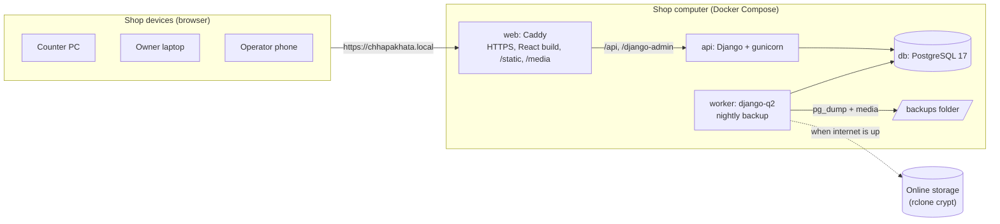
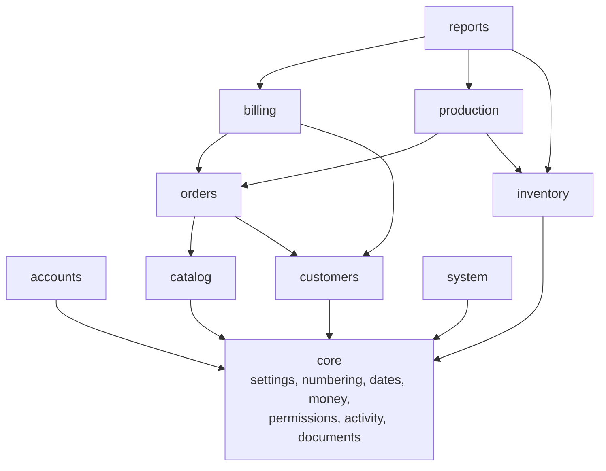

# Architecture

A single Django application serves a JSON API to a React single-page app. In the shop everything runs on one computer, reached by up to five devices over the local network. The internet is used only for the online backup copy.

## Runtime (in the shop)

## Request path

1. The browser loads the React app from Caddy (no CDN; fonts are self-hosted).
2. The app calls `/api/v1/...` on the same origin with the Django session cookie; unsafe methods send the `X-CSRFToken` header.
3. DRF authenticates the session, then `HasPerm` checks the view's `required_perms` for the action.
4. Views stay thin: they validate input with serializers and call a **service** (`services.py`) for writes or a **selector** (`selectors.py`) for reads.
5. Services run inside `transaction.atomic()`, lock rows that hold balances (`SELECT … FOR UPDATE`), and write the activity log.
6. Errors use one envelope (`drf-standardized-errors`), which the frontend maps onto form fields.

## Backend modules and dependencies

Rules that keep this healthy:

- **Money is `Decimal`** everywhere, rounded half-up to two places at each step (`apps/core/money.py`).
- **Ledgers are append-only.** `StockMovement` and `LedgerEntry` refuse updates and deletes; corrections are new rows.
- **Numbers are allocated inside the caller's transaction** with a row lock (`apps/core/sequences.py`), so they are unique and gap-free; invoices and receipts restart each fiscal year.
- **Prices come only from `apps/catalog/pricing.py`**, a set of pure functions with no database access.
- **Snapshots:** order lines store the rate and minimum used; invoices store the buyer's details and lines. Later edits never change past documents.

## Frontend structure

| Folder | Contents |
|---|---|
| `src/app` | Providers, router (lazy-loaded pages), theme, i18n, app shell |
| `src/api` | Typed client generated from the OpenAPI schema (`schema.d.ts`), error class, file downloads |
| `src/auth` | Session state, login, `<Can>` and route guard |
| `src/components` | Shared pieces: page header, money, dual dates, badges, stat card, empty and error states |
| `src/features/*` | One folder per area: dashboard, orders, production, customers, billing, inventory, reports, settings |
| `src/lib` | Formatting (lakh grouping), permissions mirror, statuses, list state in the URL |

Server state lives in TanStack Query; there is no global client store. List filters live in the URL so the back button restores them. The production board refreshes every 30 seconds.

## API contract

`backend/schema.yml` is generated by drf-spectacular and committed. `npm run api:types` turns it into `frontend/src/api/schema.d.ts`. CI fails if either is stale, so a breaking API change shows up as a TypeScript error, not at the counter.

## Why not…

- **Next.js:** server rendering adds a Node process in the shop for no benefit on an internal LAN app.
- **JWT:** session cookies with CSRF avoid storing tokens in the browser and need no refresh logic.
- **Celery + Redis:** django-q2 with the database as broker covers one nightly job without another service.
- **SQLite:** PostgreSQL gives row locks, `pg_trgm` search and reliable concurrent access for five users.
