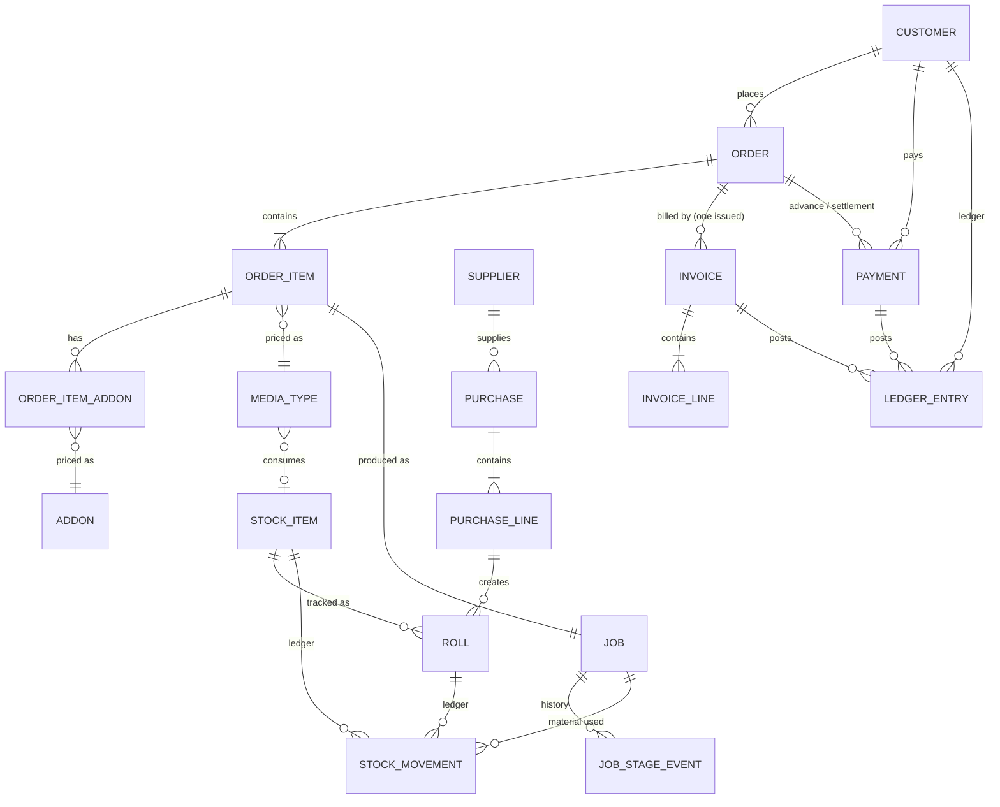

# Domain model

## Key entities

| Entity | Notes |
|---|---|
| `ShopSettings` | Single row: shop identity, VAT, default minimum sq ft, discount limit, logo/stamp/signature, numbering patterns. History-tracked. |
| `DocumentSequence` | Counter per document type and (for invoices/receipts) fiscal year. |
| `Customer` | Name, phone, PAN (9 digits), type. Balance is computed from the ledger, never stored. |
| `MediaType` / `AddOn` | The rate card. Add-on basis: fixed, per piece, per sq ft, per running ft (perimeter), percent. History-tracked. |
| `Order` | Status: quotation → confirmed → in production → ready → delivered (or cancelled). Totals stored at save. |
| `OrderItem` | Size, unit, quantity, and **snapshots** of rate and minimum; computed sq ft and amounts. |
| `Job` | One per item: `JOB-1001`…, stage 1–6 (0 = cancelled), deadline, operator, `material_recorded`. |
| `StockItem` / `Roll` | Roll media are tracked per roll (`R-0001`), other items by quantity. `on_hand` and `remaining_sqft` are cached balances. |
| `StockMovement` | Append-only: opening, purchase, consumption, wastage, adjustment, with balance after. |
| `Invoice` | Number per fiscal year, buyer snapshot, totals, status issued/cancelled, `print_count`. One issued invoice per order (database constraint). |
| `Payment` | Receipt number per fiscal year, mode details, advance flag, valid/void. |
| `LedgerEntry` | Append-only: opening, invoice, invoice cancel, payment, payment void, adjustment. Balance = Σdebit − Σcredit (positive = customer owes). |
| `ActivityLog` | Who did what and when, with IP. |
| `BackupRun` | Each backup's result, size, checksum and online-copy status. |

## Order status from job stages

| Jobs (excluding cancelled) | Order status |
|---|---|
| all in Design | Confirmed |
| any beyond Design | In production |
| all at Ready for collection or later | Ready |
| all Delivered | Delivered |
